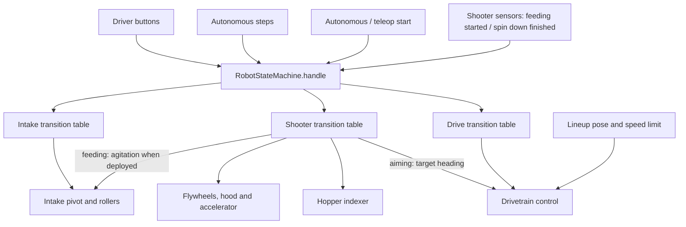
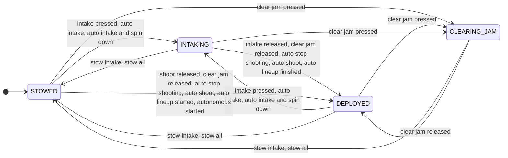
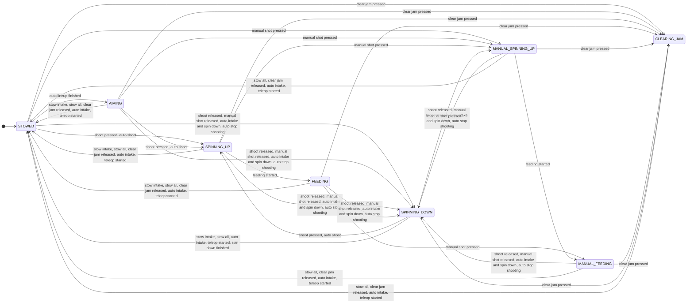
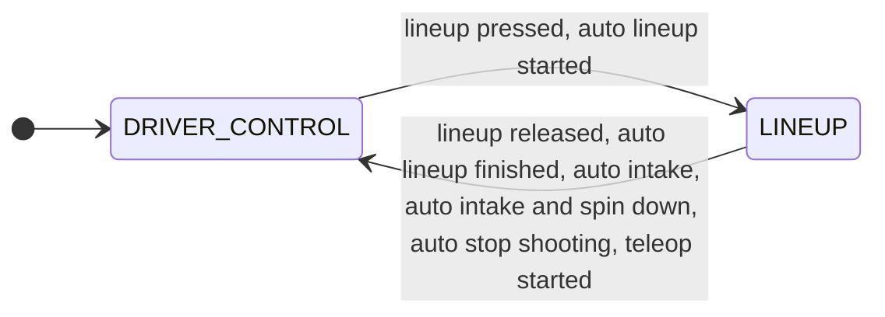
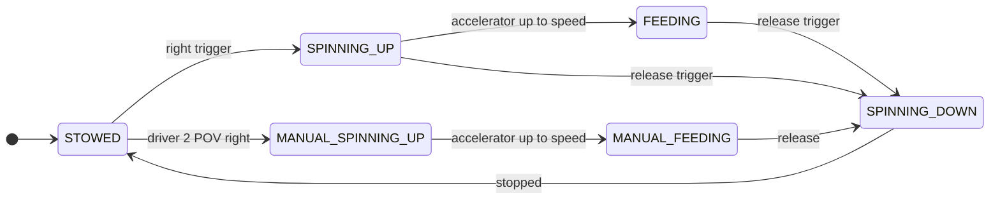
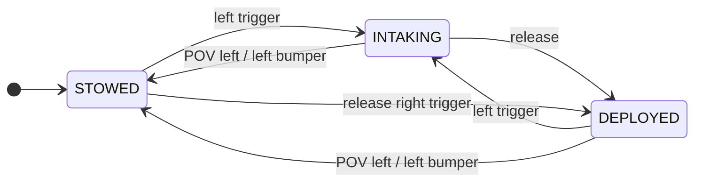

# Robot state machine

The intake, shooter and drivetrain used to be driven by about 25 boolean
flags (`shoot_intent`, `spin_down`, `intake_at_default`, `pulse_pivot`,
`accel_good`, `running_pid_lineup`, `run_p1`/`done_p1`, …). Buttons and auto
steps set several of them at once, and each subsystem decided what to do from
whichever combination it saw. Teleop alone could reach 144 different flag
combinations.

Now the robot is always in exactly **one state for each part**:

| Part | States |
|------|--------|
| Intake  | `STOWED`, `DEPLOYED`, `INTAKING`, `CLEARING_JAM` |
| Shooter | `STOWED`, `AIMING`, `SPINNING_UP`, `FEEDING`, `MANUAL_SPINNING_UP`, `MANUAL_FEEDING`, `SPINNING_DOWN`, `CLEARING_JAM` |
| Drive   | `DRIVER_CONTROL`, `LINEUP` |

Everything lives in [`state_machine.py`](state_machine.py). States only change
when something sends an **event** (`robot.state.handle(Event.SHOOT_PRESSED)`),
and the three transition tables in that file are the complete list of changes.
If a table doesn't list the current state for an event, that part stays where
it is. Subsystems never set states; they read them in `periodic()`.

## What each state does

**Intake** ([`subsystems/intake.py`](subsystems/intake.py))

| State | Pivot | Rollers |
|-------|-------|---------|
| `STOWED` | up (-0.04) | off |
| `DEPLOYED` | down (-0.35) | off. While the shooter is feeding, it **agitates**: after 0.8 s it pulses the pivot (0.9 s out, 0.4 s in) with rollers at 45% |
| `INTAKING` | down | 85% in |
| `CLEARING_JAM` | down | 30% out |

**Shooter** ([`subsystems/shooter.py`](subsystems/shooter.py)), with the
indexer ([`subsystems/hopper.py`](subsystems/hopper.py))

| State | Robot aims at target? | Flywheels / hood | Accelerator | Indexer |
|-------|---|------------------|-------------|---------|
| `STOWED` | no | off / down | off | off |
| `AIMING` | yes | off / down | off | off |
| `SPINNING_UP` | yes | distance lookup (overspeed until the accelerator is up) | on once `ready_to_shoot()` | off |
| `FEEDING` | yes | distance lookup | on | 95% |
| `MANUAL_SPINNING_UP` | no | fixed "down bad" speed and hood | on once ready | off |
| `MANUAL_FEEDING` | no | fixed | on | 95% |
| `SPINNING_DOWN` | yes | kept spinning, then off | stopped | off |
| `CLEARING_JAM` | no | reversed / down | reversed | 70% out |

In autonomous, the shooting states only command motors inside the alliance
zone; elsewhere the motors keep their last request (unchanged from before).

**Drive**: in `LINEUP` the drivetrain PIDs to `robot.state.lineup_pose`,
pointing at the target instead when the shooter is aiming. In
`DRIVER_CONTROL` the joysticks drive in teleop (aiming while the shooter
aims), and in auto PathPlanner drives (the drivetrain turns in place to aim
when no path is running). `lineup_arrived` replaces `done_p1`/`done_p2`.

## Events

| Event | Sent by |
|-------|---------|
| `INTAKE_PRESSED` / `INTAKE_RELEASED` | driver 1 left trigger |
| `SHOOT_PRESSED` / `SHOOT_RELEASED` | driver 1 right trigger |
| `STOW_INTAKE` | driver 1 POV left (also cancels an aimed shot) |
| `STOW_ALL` | driver 1 left bumper |
| `LINEUP_PRESSED` / `LINEUP_RELEASED` | driver 1 right bumper (trench lineup) |
| `MANUAL_SHOT_PRESSED` / `MANUAL_SHOT_RELEASED` | driver 2 POV right ("down bad") |
| `CLEAR_JAM_PRESSED` / `CLEAR_JAM_RELEASED` | driver 2 POV left |
| `AUTO_INTAKE`, `AUTO_INTAKE_AND_SPIN_DOWN`, `AUTO_SHOOT`, `AUTO_LINEUP_STARTED`, `AUTO_LINEUP_FINISHED`, `AUTO_STOP_SHOOTING` | auto steps in [`coroutines.py`](coroutines.py) |
| `AUTONOMOUS_STARTED`, `TELEOP_STARTED` | `robot.py` mode changes |
| `FEEDING_STARTED` | shooter, when the accelerator reaches speed |
| `SPIN_DOWN_FINISHED` | shooter, when the indexer and accelerator have stopped |

## Complete state machine

The three regions run together: the robot has one intake state, one shooter
state, and one drive state at the same time. Each event is sent to all three
transition tables. The overview shows the event sources and the dependencies
between the regions and motor control.

The diagrams below are expanded from the actual transition tables, including
wildcard (`ANY`) rows and their explicit exceptions. Every arrow changes a
state; unlisted events and explicit self-transitions leave that region
unchanged and are omitted. Labels use the event values from `Event`.
The initial arrows show power-on defaults, not match-phase resets.

`start_lineup()` also sets the target pose and speed limit and clears
`lineup_arrived`; the drivetrain sets `lineup_arrived` when it reaches the
target. These data updates are separate from the enum transitions.

### Intake: all state-changing transitions

### Shooter: all state-changing transitions

### Drive: all state-changing transitions

## Main flows

Shooter in teleop:

Intake:

Clear jam (driver 2 POV left) moves both the intake and the shooter to
`CLEARING_JAM` from any state; releasing it leaves the intake `DEPLOYED` and
the shooter `STOWED`. The left bumper stows both from any state.

A typical auto (`right_trench_bump_robust_new_mvr`) sends:
`AUTONOMOUS_STARTED` → `AUTO_INTAKE` (while the first path runs) →
`AUTO_LINEUP_STARTED` … `AUTO_LINEUP_FINISHED` (shooter `AIMING` for one loop)
→ `AUTO_SHOOT` (until the hopper is empty or the step times out) →
`AUTO_INTAKE_AND_SPIN_DOWN` → … → `TELEOP_STARTED`.

`python state_machine.py` prints every transition as Mermaid diagrams, and
the dashboard shows `States/Intake`, `States/Shooter`, `States/Drive` and
`States/Last Event`.

## Changing behaviour

* Different reaction to a button: edit that event's row in the table.
* New button or auto step: add an `Event`, add rows for it, and call
  `robot.state.handle(Event.X)` from `oi.py` or `coroutines.py`.
* New state: add it to the enum, give it rows, and handle it in the
  subsystem's `periodic()`. `tests/test_state_machine.py` fails if a state
  can't be reached or an event is never used.

## Testing

* `python -m pytest tests/test_state_machine.py -q`: the tables (instant).
* `python tests/compare_behavior.py --baseline <git revision>`: runs the real
  robot code in simulation for 17 scripted scenarios (teleop intake, shooting,
  intake-while-shooting, manual shots, jams, cancels, lineups, driving, and
  every auto on both alliances, each followed by teleop), and compares every
  motor request, the pose and the fuel counts each loop against the given
  revision. Use it whenever a change is meant to be a pure refactor. Runs
  are deterministic: simulated time starts at zero, and the gyro and motor
  sensors are deterministic fakes.

## Differences from the flag version

The refactor was checked two ways against the flag code:

1. Every scripted scenario above was recorded on the old and new code.
2. A model of the old flags was stepped in lock-step with these tables over
   every reachable sequence of button presses and auto steps.

The new tables match the old flags for every single-driver sequence and every
auto, except for these flag-combination bugs, which were fixed on purpose:

* **Left bumper (stow all) while holding the right trigger, then releasing
  the trigger.** Before: the robot stayed locked onto the target (rotation
  stick ignored) until another shooting button. Now: it spins down and
  stops aiming, exactly like cancelling with POV left.
* **Feeding, left bumper, then a tap of the left trigger.** Before: the
  intake kept agitating forever with the shooter off. Now: it stays deployed.
* **Stow intake (POV left) during the spin-down.** Before: the spin-down
  finished without aiming. Now: the shooter stows immediately (one loop
  sooner in simulation).
* **Re-pressing driver 2's manual shot during the ~0.3 s spin-down** used to
  also aim the drivetrain; now a manual shot never aims.
* **Clear jam pressed during a spin-down** (for example driver 2 sliding the
  hat straight from manual shot to clear jam): on release the flag version
  finished that spin-down, braking the accelerator to zero for one more
  loop; now the shooter stows (accelerator neutral) straight away.
* **An auto shoot step that starts while still spinning down** used to finish
  the spin-down and then stow, skipping the volley. Now it shoots. (None of
  the current autos reach this: the spin-down finishes during the next path.)
* **Simulation only:** fuel could be intaken while the rollers were reversed
  clearing a jam.

When both drivers press conflicting buttons at once (for example driver 2
clears a jam while driver 1 holds the trigger), the old flags produced 95
different hard-to-predict combinations (some aimed while jammed, some stowed
the intake while reversing the shooter). The tables now give one defined
result for each: clear jam and the stow buttons win, and a manual shot keeps
its fixed settings.

Removed because they never changed behaviour: `shoot_fuel` and
`ignore_shooter_in_jam` (always `False`), `pulse_indexer`, `trench`,
`at_climbing_position`, `done_rotation_auto`, `should_hub_track`,
`run_p3`/`run_p4`, the unused `drivetrain.stop_intaking()`, and the unused
auto steps `p1_right_trench`/`p2_right_trench`. Those two waited for a
lineup that nothing started, so they never finished.

## Not changed

Match bookkeeping (`in_autonomous_mode`, `did_autonomous`, `auto_submitted`),
the drive heading-hold variables in `oi.py`, and the disabled snake-intake /
fuel-tracking assists are separate from this state machine and work as
before.
